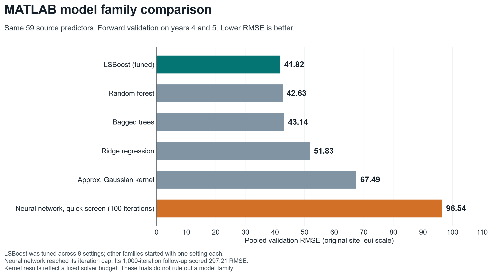
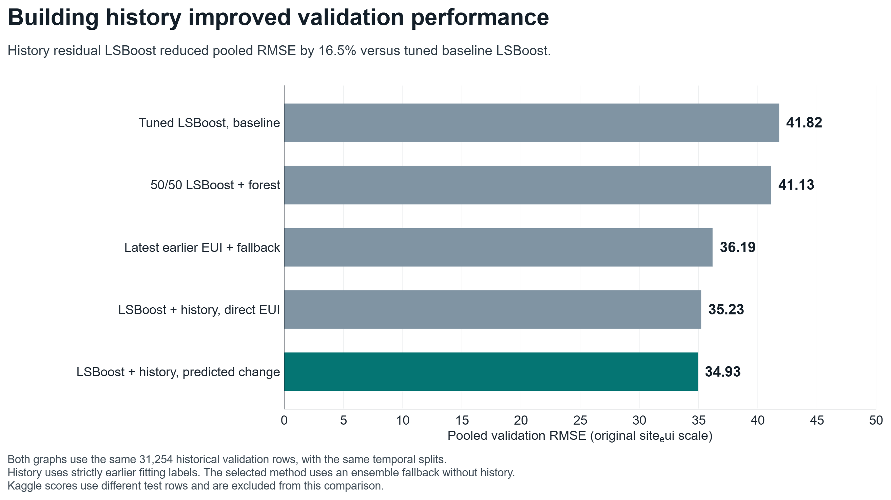

# WiDS Datathon 2022: building energy prediction in MATLAB

Predict annual building energy use intensity (`site_eui`) using building characteristics, weather, and earlier readings from matching building groups. All reported model training and inference use **MATLAB with Statistics and Machine Learning Toolbox**.

## Results

| Experiment | Historical pooled RMSE |
| --- | ---: |
| Tuned LSBoost, 59 baseline predictors | 41.8175 |
| Random forest | 42.6302 |
| Bagged trees | 43.1378 |
| Ridge regression | 51.8280 |
| Approximate Gaussian kernel | 67.4925 |
| Neural network (quick screen, 100 iterations) | 96.5427 |
| 50/50 LSBoost and random forest | 41.1337 |
| Latest earlier EUI with fallback | 36.1865 |
| LSBoost with history, direct target | 35.2257 |
| **LSBoost with history, change target and fallback** | **34.9346** |

Historical validation trains on years 1-3 to predict year 4 and on years 1-4 to predict year 5. Pooled RMSE is `sqrt(total squared error / 31254 validation rows)`. The selected method reduces RMSE by **16.46%** relative to tuned baseline LSBoost. These are model-selection folds. Year 6 was examined in earlier feature experiments, so it is not an untouched independent holdout.

The full-data MATLAB refit received **public RMSE 19.545** and **private RMSE 21.552** in a successful late Kaggle submission on 30 October 2026. Kaggle scores evaluate different rows from historical validation and are not a direct before/after improvement.





LSBoost was selected from eight configurations; the alternative families had a compact initial screen. Both neural-network budgets hit their iteration limits. The 1,000-iteration follow-up scored 297.2084. Kernel diagnostics do not establish convergence on both folds. These trials do not establish the best achievable score for every family.

The neural network is a **quick screen**, not a tuned final model. Its numeric inputs already receive training-only standardization in `shared/wids_encode.m`; categorical predictors receive one-hot encoding. The learner therefore uses `Standardize=false` to avoid applying scaling twice.

## Dataset

Download the inputs yourself from [WiDS Datathon 2022 on Kaggle](https://www.kaggle.com/competitions/widsdatathon2022/data), subject to its access requirements and rules:

```text
data/
  train.csv             # 75,757 building-year records, years 1-6
  test.csv              # 9,705 records, year 7, hidden target
  sample_solution.csv   # submission IDs and expected schema
```

The data cover commercial and residential buildings, 60 facility types, and seven anonymized state codes. The repository includes code, aggregate metrics, and charts. It excludes raw competition data, row-level predictions, fitted model binaries, credentials, and account screenshots. Downloaded data remain governed by the competition's terms.

## Run the selected model

The workflow requires a recent MATLAB release and Statistics and Machine Learning Toolbox. Development and verification use R2026b on Windows. File hashing uses Java MessageDigest instead of platform-specific APIs, with an optional mode for environments without a JVM. No Parallel Computing Toolbox or GPU is required for these local fits. MATLAB and toolbox licenses are not included.

From the repository root, run the complete five-stage solution:

```matlab
main
```

Use `setenv('WIDS_DATA_DIR','/path/to/widsdatathon2022')` if the three input CSVs are elsewhere. The root `main.m` initializes paths, runs prepare/residual/boost/forest/export, restores the original directory, and writes stage timings. The original local fits took about 62, 70, and 31 seconds. Allow roughly **2-8 minutes** for a fresh full pipeline on similar hardware; other hardware and MATLAB Online may take longer. Existing matching checkpoints are reused. A fresh isolated batch validation of this refactor took **107.4 seconds**: preparation 6.4 s, residual stage 34.4 s, boosted stage 36.5 s, forest stage 17.6 s, and export 12.1 s. These stage times include loading and saving; see `kaggle_submission/runtime_summary.csv`.

Optional hashing is the default: Java SHA256 runs when a JVM is available. Without Java, the helper emits a warning and returns an explicit `METADATA_ONLY:size:time` fingerprint. Same-size/same-time edits cannot be detected in that mode. `setenv('WIDS_CHECKSUM_MODE','strict')` requires Java SHA256, while `off` always uses metadata. The source/configuration and schema guards remain active. R2026b no longer bundles a JRE by default; see [MathWorks Java configuration](https://www.mathworks.com/help/matlab/matlab_external/configure-your-system-to-use-java.html). See [MathWorks usejava documentation](https://www.mathworks.com/help/matlab/ref/usejava.html).

All reported training, validation, and test prediction runs used the local MATLAB installation. The portable refactor does not change estimator settings or recorded scores. Other operating systems and MATLAB Online have not been runtime-tested here.

Export creates `kaggle_submission/wids_history_residual_submission.csv` in sample-ID order and checks 9,705 unique IDs, two columns, finite values, exact numeric readback, and data/model/source identity. No automatic Kaggle login or submission occurs.

The residual model uses 300 trees, learning rate 0.05, maximum 31 splits, minimum leaf size 5, and seed 42. It fits 49,384 labeled rows with earlier history. Both fallback models fit all 75,757 labeled rows. Of the test rows, 9,067 have matching history and 638 use the fallback. No target log transform, clipping, or calibration is applied.

## History features and leakage controls

Infer a group using the **raw** tuple `State_Factor`, `building_class`, `facility_type`, `floor_area`, and `year_built`, before median imputation. This is an identity proxy, not a verified unique physical-building identifier.

The eight features are history availability, count of earlier observed years, latest EUI, equal-year mean EUI, second-most-recent EUI, time gap since latest EUI, latest nonmissing energy-star rating, and rating change. Average duplicate building-year values before aggregation. Six history missingness flags expand the 59-predictor baseline to 73 columns. Numeric inputs remain on their original scales for the final tree models.

A row at year t can use only fitting-label history from years earlier than t. Fit preprocessing and history-value replacements on training rows only. The history helper accepts validation/test tables without a target column. The synthetic check exercises duplicate averaging, temporal gaps, and invariance to same-year, future-year, and query labels.

## Reproduce comparisons and charts

Run lightweight project checks with `setup_wids_project; addpath('tests'); test_project`. These check shared-file resolution, history leakage controls, and checksum modes. SHA256 known vectors run when Java is available; otherwise the checks verify that strict mode refuses to run and the metadata fallback works.

After `setup_wids_project`, run the following workflows from their folders:

1. `local_tuning/run_local_tuning`: regenerate LSBoost checkpoints and aggregate scores.
2. `local_model_comparison/run_model_comparison`: fit five alternative CPU configurations on both folds. Then run `verify_model_comparison` and `evaluate_wids_blends`.
3. `local_model_comparison/check_building_history_logic`, `run_building_history_case(4)`, `run_building_history_case(5)`, and `summarize_history_results`: reproduce the history comparison.
4. `model_comparison_charts/create_model_comparison_charts`: redraw the supplied aggregate results in MATLAB, exporting PNG, SVG, FIG, and CSV locally.

Pretrained checkpoints are intentionally absent. Run tuning before comparison verifiers or history experiments that depend on L07. The optional longer network uses `run_longer_network_case(4)` and `(5)`.

Public copies use configurable data paths and fresh checkpoint signatures. Their verifier references point to the published current tuning sources. Previously recorded CSV scores are historical evidence; regenerated model objects require new computation and can differ across MATLAB releases.

## Repository layout

| Folder | Contents |
| --- | --- |
| `shared` | Canonical cleaning, history, encoding, checksums, and predictor list |
| `kaggle_submission` | Full-data staged MATLAB training and prediction export |
| `local_tuning` | Eight LSBoost configurations and recorded metrics |
| `local_model_comparison` | Model families, history experiments, verification, and results |
| `model_comparison_charts` | MATLAB plotting code and presentation charts |
| `feature_experiments` | Earlier feature engineering and ablation experiments |


## Sources

- [WiDS Datathon 2022](https://www.kaggle.com/competitions/widsdatathon2022)
- [MathWorks building-regression tutorial](https://github.com/mathworks/predicting-building-energy-consumption)

